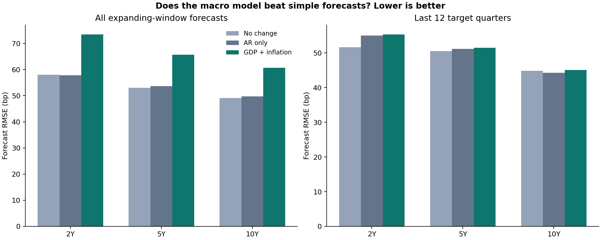

# Macro Yield Model — Forecasting the Treasury Curve Slope with Macro Data

> A two-stage, fully documented research model: can macroeconomic data — growth, labor, policy, oil, and survey expectations — forecast the U.S. Treasury yield-curve slope better than a simple autoregression? Built with real-time (vintage) data discipline, expanding-window evaluation, integrity tests, and a written model-design paper.



## The two stages

**Stage 1 — Design & starter system.** Research design, data contract, feature engineering, SQLite schema, yield snapshot, and a demo forecasting model with integrity tests. Design paper: `research/MODEL_DESIGN.md`. Report: `reports/Stage1_Macro_Model_Design_Report.pdf`.

**Stage 2 — Real-time vintage panel.** Quarterly panel built from ALFRED vintages (data as it was actually known at the time — no look-ahead), Philadelphia Fed SPF expectations, and FRED series (GDP, unemployment, Brent oil, Treasury holdings). Feature families — macro, labor, policy, oil, supply — are compared on common-vintage and long samples with expanding-window forecasts, coefficient-stability checks, and conditional scenarios. Report: `reports/Stage2_Report.pdf`.

## Highlights

- **No look-ahead bias:** vintage downloads (`download_vintages.py`) and release-date handling throughout
- **Honest benchmarking:** every feature family is scored against an AR baseline (`outputs/stage2/forecast_comparison.csv`)
- **Tested:** integrity tests in `tests/`; validation notes in `VALIDATION.md`; exact package versions in `tested_versions.json`
- **Reproducible:** `run_stage2.py` rebuilds the panel and reruns the analysis; sources documented in `research/SOURCES.md`

## Run it

```bash
pip install -r requirements.txt
python snapshot.py        # current yield-curve snapshot
python run_stage2.py      # stage 2 panel + analysis
python -m unittest discover -s tests -v
```

Large generated artifacts (the Stage 2 SQLite database and the raw ALFRED vintage zips) are not committed — the download and build scripts regenerate them.

## Structure

```
model.py / features.py / snapshot.py   stage 1 model system
build_panel.py / analyze_stage2.py     stage 2 vintage panel + analysis
download_stage2.py / download_vintages.py
sql/                     schema + analysis queries
research/                MODEL_DESIGN.md, SOURCES.md
data/                    quarterly panels, feature audit, raw FRED snapshots
outputs/                 stage 2 coefficients, forecasts, scenarios, charts
reports/                 stage 1 design report + stage 2 report (PDF)
tests/                   integrity tests
```

## Data sources (all public)

FRED / ALFRED (Federal Reserve Bank of St. Louis), Survey of Professional Forecasters (Federal Reserve Bank of Philadelphia).

## Author

**Umer Farooq** — Economic & Climate Risk Analyst · [LinkedIn](https://www.linkedin.com/in/umer-farooq-gojra/) · [GitHub](https://github.com/umerfarooq7424)

## License

MIT — see LICENSE.

> Note: per-family sample output folders (long sample / common-vintage sample) are generated by `run_stage2.py` and are not committed; the headline stage-2 outputs above are included.
